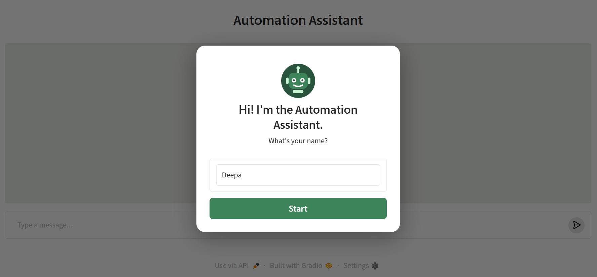
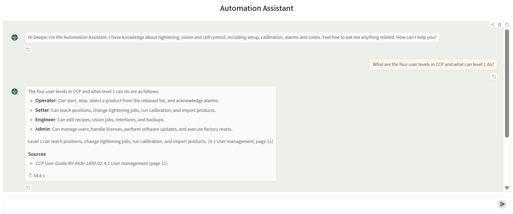

# Automation Assistant

## Overview
Prototype RAG assistant for an assembly/fastening process (torque tightening). It answers only from the PDF manuals you give it, runs fully locally, and is free to use.

> **All data in this project is fictional.** The manuals (TC-6000, CCP, VS-Guide, FC-200 and so on, from the fictional company "Norvik Automation AB") are made-up documents. **No company data, names or part numbers were used.** The answers in the screenshots come from these fictional manuals.

## Screenshots
The app asks for your name, then answers only from the manuals and cites the section and page.





## Features
- Answers only from the documents; replies "I couldn't find that in the document." otherwise
- Section-aware chunking: a section can span several pages, so procedures are not cut off at a page break
- Citations with document, section and page range
- Follow-up questions ("What must be done afterwards?") using conversation context
- A short progress bubble ("Retrieving chunks…", "Generating answer…") while it works, and the total response time under every answer
- The chat window fills the browser window (zoom out to see a long conversation)
- Asks for your name in a pop-up and greets you personally; greetings and thanks ("hi", "thanks") get an instant reply without calling the model

## Tech stack
- Ollama: qwen2.5:7b (chat), nomic-embed-text (embeddings)
- ChromaDB (vector store), Gradio (UI), pypdf (PDF text)

## Setup
Windows PowerShell, from the project folder.

1. Install [Ollama](https://ollama.com), then pull the two models:
   ```powershell
   ollama pull qwen2.5:7b
   ollama pull nomic-embed-text
   ```
2. Create the virtual environment and install the dependencies (Python 3.12):
   ```powershell
   py -3.12 -m venv .venv
   .venv\Scripts\python -m pip install -r requirements.txt
   ```
3. Put your PDF manuals in `data/raw/` (not committed).
4. Build the index (rebuilds `chroma_db/`; only needed when the PDFs or `scripts/ingest.py` change):
   ```powershell
   .venv\Scripts\python scripts\ingest.py
   ```

## Usage
```powershell
.venv\Scripts\python app.py
```
Open http://127.0.0.1:7860. Restart the app after changing `app.py`.

Optional settings (environment variables, read at start-up):
- `CHAT_MODEL`: another Ollama model, default `qwen2.5:7b`.

Other:
- `.venv\Scripts\python scripts\ingest.py --dry-run` lists the sections and chunks without calling Ollama.
- `tests/questions.md` has questions to try by hand, including ones that must be refused.

## Project structure
```
Automation-assistant/
├── app.py               # Gradio chat app (retrieval, answering, progress bubble)
├── requirements.txt     # Python dependencies
├── README.md            # this file
├── assets/              # agent avatar
├── CLAUDE.md            # project rules
├── DATA_SOURCES.md      # every data source, with license and credit
├── .gitignore           # keeps data/raw/, chroma_db/, .venv/ and .env out of git
├── scripts/
│   ├── ingest.py        # PDFs in data/raw/ -> chunks -> embeddings -> chroma_db/
│   └── download_data.py # placeholder: the PDFs are supplied locally, nothing is downloaded
├── docs/                # documentation for non-specialists (start at docs/README.md)
├── tests/
│   └── questions.md     # test questions to try by hand
├── data/
│   ├── raw/             # your input PDFs (not committed)
│   ├── docs/            # reserved, currently unused
│   └── templates/       # reserved, currently unused
├── chroma_db/           # generated search index (not committed)
└── .venv/               # Python environment (not committed)
```

## Documentation
Full documentation for non-specialists, from the basics to design decisions and future ideas, is in [docs/](docs/README.md): [overview](docs/00-overview.md), [concepts](docs/01-concepts-from-zero.md), [architecture](docs/02-architecture.md), [life of a question](docs/03-life-of-a-question.md), [design decisions](docs/04-design-decisions.md), [troubleshooting](docs/05-running-and-troubleshooting.md), [limits and future](docs/06-limits-and-future.md) and a [glossary](docs/glossary.md).

## Data and licenses
See [DATA_SOURCES.md](DATA_SOURCES.md). Raw data in `data/raw/` and the generated `chroma_db/` are not committed.

## Disclaimer
**The documents are fictional.** Only open data and fictional documents are used. No company data, names or part numbers.

## License
TBD
