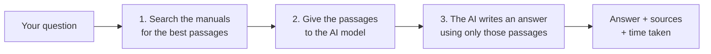

# 00 Overview (5 minutes)

## What is this?

A chatbot that answers questions about technical manuals. You type a question in plain language, for example "How do I replace the camera?", and it answers with the steps and tells you which section and pages of which manual it used.

It is a **prototype**: a working demonstration built to learn what is possible, not a finished product.

## The one idea behind it

An AI model knows a lot about the world, but it has never seen *your* manuals, and when it does not know something it tends to produce a confident-sounding guess. So instead of asking the AI from memory, the chatbot works like an **open-book exam**:

1. **Look up** the few passages in the manuals that are most relevant to your question.
2. **Hand those passages to the AI** and tell it: answer using only this text, and if the answer is not here, say so.
3. **Show the answer** together with its sources.

This technique is called **RAG** (retrieval-augmented generation: "look things up, then write the answer"). You will see the word RAG in the rest of the documentation; it just means this open-book approach.

## Three real examples

These are real outputs from the prototype (shortened).

**1. A procedure, spread over two pages**

> **You:** How do I replace the camera?
> **Chatbot:** To replace the camera, follow these steps: 1. Stop the cell and lock out the main switch. 2. Disconnect the camera cable and the power cable. ... 6. Run the hand-eye calibration and teach the reference position. 7. Run 30 reference parts and check the match score.
> *Source: FC-200 Operating and Service Manual, section 7.5 Replacing the camera, pages 13-14*

The procedure starts at the bottom of page 13 and ends at the top of page 14. Early versions of the chatbot stopped after step 5 because they read one page at a time. See [section-aware chunking](04-design-decisions.md#section-aware-chunking).

**2. A follow-up question**

> **You:** What must be done afterwards?
> **Chatbot:** After replacing the camera: 1. Run the hand-eye calibration and teach the reference position. 2. Run 30 reference parts and check the match score.

"Afterwards" means nothing on its own. The chatbot first rewrites the question to "What must be done after replacing the camera?" and then searches. See [why the rewrite exists](04-design-decisions.md#rewriting-follow-up-questions).

**3. A question the manuals cannot answer**

> **You:** What is the capital of France?
> **Chatbot:** I couldn't find that in the document.

This refusal is deliberate. The chatbot is meant to be trustworthy about *its documents*, not a general-knowledge assistant.

## What it can and cannot do

| It can | It cannot (yet) |
|---|---|
| Answer questions from the five manuals and cite section and pages | Answer from documents it has not been given |
| Handle follow-up questions in the same chat | Guarantee it is right. It can still misread a passage, especially tables |
| Say "I couldn't find that" for off-topic questions | Compare several documents reliably, or reason over long chains of facts |
| Show what it is doing while it works, and how long it took | Answer quickly. On this laptop an answer takes roughly 20 to 60 seconds |
| Run fully offline on one laptop, for free | Serve many users at once |

## Why does it run on the laptop and not in the cloud?

The project rules ask for free and local only. Technical manuals are often confidential, and a local setup means nothing is sent to an outside service. The price is speed: a laptop without a graphics card writes text slowly. See [Why local](04-design-decisions.md#local-and-free-only).

## At a glance

| | |
|---|---|
| Documents | 5 fictional manuals, 109 pages in total |
| Searchable pieces | 273 sections ("chunks") |
| AI model that writes answers | `qwen2.5:7b` (about 4.7 GB), run with Ollama (a free program that runs AI models on your own computer) |
| Model that understands meaning for the search | `nomic-embed-text` (about 0.3 GB) |
| Search storage | ChromaDB, a folder on disk |
| Screen | A chat web page made with Gradio (a toolkit for simple web screens), at `http://127.0.0.1:7860` |
| Typical time per answer | About 20 to 60 s on the development laptop (measured) |

Next: [01 Concepts from zero](01-concepts-from-zero.md) explains the words used here from scratch, or jump to [03 Life of a question](03-life-of-a-question.md) to follow one question step by step.
