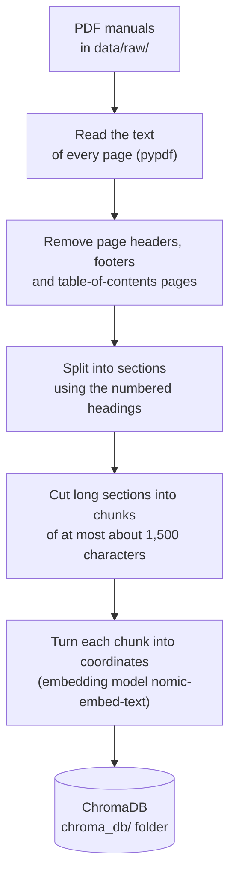
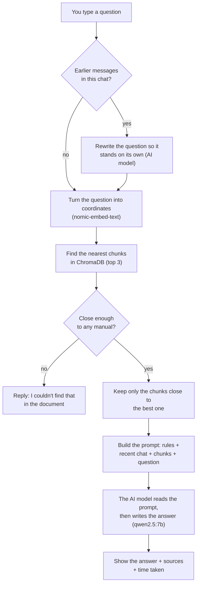
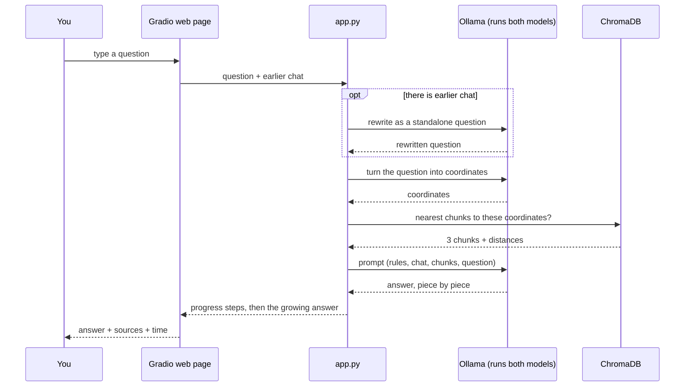

# 02 Architecture

How the pieces fit together. If a word is new, see [01 Concepts](01-concepts-from-zero.md) or the [glossary](glossary.md).

## The big picture: two separate jobs

The system does two different jobs at two different times:

1. **Preparing the library (ingest)**. Done once, or again whenever the manuals change. Slow, offline, no user involved.
2. **Answering questions (ask)**. Done every time someone types a question. Uses the prepared library.

Think of a library: first someone catalogues all the books (ingest), later visitors ask the librarian questions (ask).

## Job 1: Ingest (prepare the library)

Run with `scripts/ingest.py`. It takes the PDF manuals and produces a searchable index.



What ends up stored for each chunk (273 chunks for the five manuals):
- the **text** of the chunk,
- its **coordinates** (the embedding),
- its **source details**: which PDF, the section heading, and the first and last page it covers.

The source details are what later let the chatbot say "section 7.5, pages 13-14".

## Job 2: Ask (answer a question)

Run by `app.py` every time a question is submitted.



The same flow as a conversation between the parts:



## The components

| Component | What it is | Its job here | Runs |
|---|---|---|---|
| **Ollama** | A program that runs AI models on your computer | Hosts both models and answers requests from `app.py` | Local background service |
| **`qwen2.5:7b`** | The language model (about 4.7 GB) | Rewrites follow-up questions and writes answers | Inside Ollama, on the CPU (the computer's main processor) |
| **`nomic-embed-text`** | The embedding model (about 0.3 GB) | Turns text into coordinates (for chunks and for questions) | Inside Ollama, on the CPU |
| **ChromaDB** | A small vector database | Stores chunks and finds the nearest ones | Inside `app.py`, files in `chroma_db/` |
| **Gradio** | A Python toolkit for web screens | The chat page, streaming text, progress bubble | Inside `app.py`, port 7860 |
| **pypdf** | A PDF text reader | Extracts text from the manuals during ingest | Inside `ingest.py` |

The chatbot never sends your questions or the manuals' text to a cloud AI service. The internet is needed to install the software and download the models once. One caveat: some of the libraries used (ChromaDB, Gradio) may send anonymous usage statistics by default, but not documents. That was not checked on this machine; see the small print in [Design decisions](04-design-decisions.md#local-and-free-only).

## Folders and files

```
app.py                    The chat app: question in, answer out (Job 2)
assets/                   The agent avatar
requirements.txt          The Python packages the project needs
scripts/ingest.py         Prepares the library from the PDFs (Job 1)
scripts/download_data.py  Placeholder. The PDFs are supplied locally
data/raw/                 The input PDFs (not committed to git)
chroma_db/                The generated index (not committed to git)
tests/questions.md        Questions to try by hand
docs/                     This documentation
README.md                 Short project introduction and setup steps
CLAUDE.md                 The project rules (local and free only, fictional data only, ...)
DATA_SOURCES.md           Every data source with its license and credit
.gitignore                Keeps data/raw/, chroma_db/, .venv/ and .env out of git
```

Two folders, `data/docs/` and `data/templates/`, exist but are unused. Do not confuse `data/docs/` (reserved for input documents, empty) with `docs/` (this documentation).

## Where things are remembered

| What | Where | How long |
|---|---|---|
| The manuals' text and coordinates | `chroma_db/` on disk | Until you run ingest again |
| The conversation so far | The browser page's session | Until you refresh or close the page |
| The AI models | In memory while in use, kept loaded for 30 minutes after the last question | Then unloaded to free memory |

`app.py` itself keeps no memory of past questions. Each time, the web page sends the earlier messages along with the new one.

## A rule that connects both jobs

The **same embedding model** must be used when preparing the library and when asking. If they differ, the coordinates are on two different maps and the search returns nonsense. Today both `app.py` and `scripts/ingest.py` set `nomic-embed-text`. If you ever change one, change the other and re-run ingest.

Next: [03 Life of a question](03-life-of-a-question.md).
